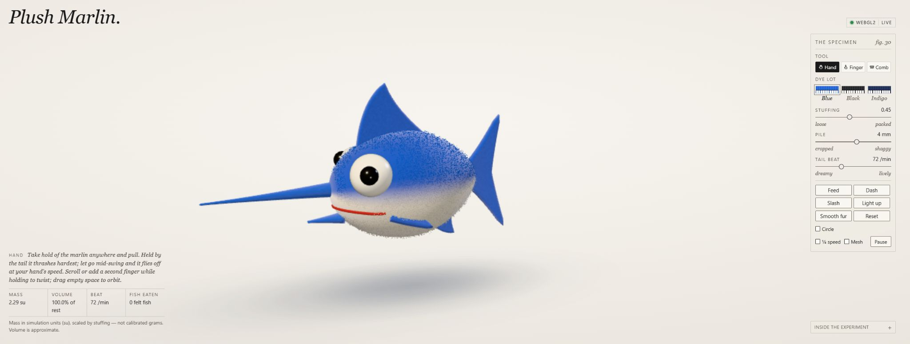
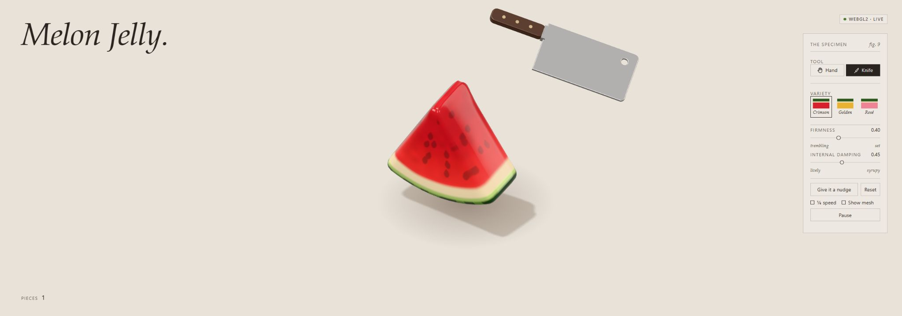
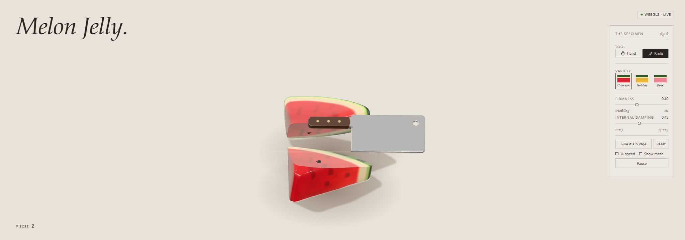

# reference-to-web-toy

A Codex skill for turning video or screenshot references into interactive web toys, checking controls and motion against the reference, and verifying portable static app artifacts.

인스타그램 릴스·영상·스크린샷 속 장난감을 직접 조작하는 웹앱으로 만드는 스킬입니다. 기존 앱의 빠진 기능이나 다른 동작·패널을 원본과 대조해 보정할 때도 사용할 수 있습니다.

## 설치

Codex의 skills 폴더에 이 저장소를 복제합니다. 같은 이름의 스킬이 이미 있으면 먼저 확인하고 다른 작업을 덮어쓰지 마세요.

macOS / Linux:

```sh
mkdir -p "${CODEX_HOME:-$HOME/.codex}/skills"
git clone https://github.com/Bum-Boo/reference-to-web-toy.git "${CODEX_HOME:-$HOME/.codex}/skills/reference-to-web-toy"
```

Windows PowerShell:

```powershell
$skillRoot = if ($env:CODEX_HOME) { Join-Path $env:CODEX_HOME 'skills' } else { Join-Path $HOME '.codex/skills' }
New-Item -ItemType Directory -Force -Path $skillRoot | Out-Null
git clone https://github.com/Bum-Boo/reference-to-web-toy.git (Join-Path $skillRoot 'reference-to-web-toy')
```

스킬 목록을 다시 불러오도록 Codex에서 새 대화를 시작하고 호출합니다. 이 저장소에는 완성된 장난감 앱이나 원본 영상이 포함되지 않습니다.

## 사용

```text
$reference-to-web-toy 이 인스타 영상처럼 직접 만질 수 있게 만들어줘: 영상 링크
$reference-to-web-toy 기존 앱의 원본 패널과 누락 기능을 대조해서 맞춰줘.
```

스킬은 원본 프레임·조작 전후를 확인하고 요구 대조표를 작성한 뒤, 장면 구현·전체 조작부 보정·실제 브라우저 입력/화면 검사·버전 일치와 재실행 전달을 안내합니다. 읽지 못한 기능을 추정해 채우거나 파일 일치만으로 원본과 같다고 판단하지 않습니다.

특정 모델·MCP·개인 경로나 Wiki가 필요하지 않습니다. 앱을 만들고 실제로 확인하려면 사용 환경에 코드 실행과 브라우저/이미지 확인 도구가 있어야 합니다. 프로젝트에 적용되는 역할·리뷰·게시 승인 지침을 따릅니다.

## 제작 데모

직접 만든 앱을 브라우저에서 실행해 캡처했습니다. 이미지를 클릭하면 원래 크기로 볼 수 있습니다.

### 청새치

[](docs/demos/marlin.jpg)

[실제 CLI 제작 프롬프트 발췌](docs/demos/marlin-prompt.txt)

### 젤리 수박

[](docs/demos/watermelon.jpg)

칼 모드에서 직접 드래그해 두 조각으로 자른 화면입니다.

[](docs/demos/watermelon-cut.jpg)

[실제 CLI 제작 프롬프트 발췌](docs/demos/watermelon-prompt.txt)

프롬프트는 제작 당시 Claude CLI의 표준 입력으로 전달한 지시에서 기능 부분을 그대로 발췌한 텍스트입니다. 원본 링크와 내부 운영 지시는 제외했습니다. 과거 터미널 화면을 재현한 이미지는 사용하지 않았습니다. 초기 작성 뒤 기능·패널 보정을 거쳤으므로 한 번의 프롬프트만으로 완성됐다는 예시는 아닙니다.

## 파일

- [SKILL.md](SKILL.md): 진입 지침과 호출 조건.
- [원본 분석](references/reference-analysis.md): 프레임 판독, 기능/패널/모션 대조.
- [런타임과 전달](references/runtime-and-delivery.md): 실제 입력·화면·소스 버전·포터블 패키지 확인.
- [검증 helper](scripts/verify_static_artifact.py): 정적 파일·선택적 loopback HTTP·ZIP 바이트 비교.

## 정적 산출물 검사

Python3.10 이상, 외부 Python 패키지 없이 실행합니다. 앱의 실제 파일만 `--asset`으로 선언합니다. receipt 부모 폴더는 미리 만들고 새 출력 이름을 사용합니다.

```sh
python -X utf8 scripts/verify_static_artifact.py --root ./toy-app --asset serve.py --zip ./toy-app/Toy.zip --out ./static-version.json
```

HTTP 비교는 `--url http://127.0.0.1:8080/`처럼 실제 실행 주소를 추가합니다. 기대 entry 버전은 `--expected-sha`, 이전 script/asset 비교는 `--baseline-receipt`, ZIP 내부 폴더는 `--zip-prefix`로 지정합니다.

종료 코드0과 `PASS`는 선언한 파일의 일치만 뜻합니다. helper는 앱 파일을 수정하거나 ZIP을 추출하지 않으며 기존 receipt를 덮어쓰지 않습니다. 기능·화면·리뷰는 별도 실제 근거가 필요합니다.

## 테스트

```sh
python -X utf8 scripts/test_verify_static_artifact.py -v
```

실제 임시 HTTP 서버와 ZIP을 사용해 오래된 응답/패키지, 기대 SHA 불일치, CSS와 runtime asset 변경, 덮어쓰기 거부, prefix/중복 경로, loopback/redirect 제한, 검사 중 파일 변경을 확인합니다. GitHub Actions는 Windows/Linux와 Python3.10/3.13에서 이 테스트를 실행합니다.

## 라이선스

[MIT](LICENSE). 이 저장소의 지침과 helper에 적용됩니다. 제작에 쓰는 원본 영상·모델·텍스처 등 외부 자산의 사용 조건은 해당 원출처에서 확인합니다.
